<h1>Ali Mustopa, M.Kom.</h1>

  <b>Lektor Informatika · Image Processing · Mobile &amp; Web Engineer</b> 
  <i>Universitas Bina Sarana Informatika (UBSI), Kampus Kota Pontianak</i>

  

<h3><code>alimustopaaop@github ~ $ ./contributions.sh</code></h3>

  

<h3><code>alimustopaaop@github ~ $ whoami</code></h3>

<table>
  <tr>
    <td valign="top" width="50%">
      
    </td>
    <td valign="top" width="50%">
      
    </td>
  </tr>
</table>

  

<h3><code>alimustopaaop@github ~ $ ./academic.sh</code></h3>

<table>
  <tr>
    <td align="center"><b>Position</b></td>
    <td align="center"><b>NIDN</b></td>
    <td align="center"><b>Code</b></td>
    <td align="center"><b>SINTA</b></td>
  </tr>
  <tr>
    <td align="center">Lektor, Informatika</td>
    <td align="center"><code>0327119601</code></td>
    <td align="center"><code>AOP</code></td>
    <td align="center"><a href="https://sinta.kemdikbud.go.id/authors/profile/6724399"><b>941</b></a> (3Yr: 449)</td>
  </tr>
  <tr>
    <td align="center"><b>Scholar h-index</b></td>
    <td align="center"><b>Scopus ID</b></td>
    <td align="center"><b>Garuda ID</b></td>
    <td align="center"><b>Profile</b></td>
  </tr>
  <tr>
    <td align="center"><a href="https://scholar.google.com/citations?user=ECAjlo4AAAAJ"><b>11</b></a></td>
    <td align="center"><a href="https://www.scopus.com/authid/detail.uri?authorId=58944153500"><code>58944153500</code></a></td>
    <td align="center"><a href="https://garuda.kemdikbud.go.id/author/view/628093"><code>628093</code></a></td>
    <td align="center"><a href="https://saysv2.bsi.ac.id/profilpreview/202110259">SAYS UBSI</a></td>
  </tr>
</table>

Research: Digital Image Processing · Computer Vision · CNN · Applied AI

  

<h3><code>alimustopaaop@github ~ $ ./stack.sh</code></h3>

<table>
  <tr>
    <td align="right"><code>mobile</code></td>
    <td></td>
  </tr>
  <tr>
    <td align="right"><code>web</code></td>
    <td></td>
  </tr>
  <tr>
    <td align="right"><code>ai</code></td>
    <td></td>
  </tr>
  <tr>
    <td align="right"><code>design</code></td>
    <td></td>
  </tr>
</table>

  

<h3><code>alimustopaaop@github ~ $ ./contact.sh</code></h3>

<!-- Tambahkan LinkedIn dengan URL profil Anda yang asli:

-->

  

<i>"Bridging the gap between intelligent image processing, clean mobile design, and robust web engineering."</i>

